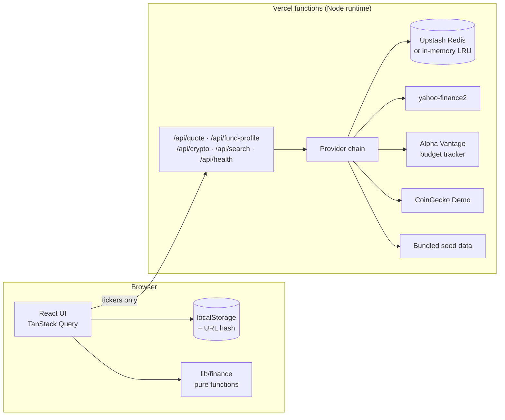

# Overlap

**See what your funds really hold, where they overlap, and what fees cost you in dollars.**

Retail investors often think they're diversified because they own several funds. But three S&P 500 index funds, a total-market fund and a tech ETF can put a quarter of a portfolio in the same five companies. Overlap looks through each fund to the companies it holds, measures how much the funds overlap, and turns expense ratios and advisory fees into dollars per year and over decades. It never predicts returns.

Built for **RedHawk Builds 2026** (Miami University), Challenges **17: Portfolio concentration** and **18: Investment fee impact**.

> Informational only, not investment advice. Prototype: check each data provider's terms before any commercial use.

## What it does

| Tab | What you see |
|---|---|
| **Portfolio** | Build a portfolio by ticker search, CSV paste/upload, or a one-click sample (including the RedHawk starter-pack holdings, labeled synthetic). Live prices and expense ratios, each with a source and "as of" badge. |
| **Concentration** | Look-through exposure by company (with which funds contribute), sector and asset class; a pairwise fund-overlap heatmap; HHI, effective number of holdings, top-1/5/10 share; flags with thresholds you can edit. |
| **Fees** | Annual fees in dollars and percent by holding and in total, an advisory fee editor (flat or marginal tiers), and a fee-drag sensitivity grid across return assumptions and horizons. |
| **Compare schedules** | 2 to 4 fee schedules applied to the same balance and the same gross return, so the comparison doesn't depend on a forecast. |
| **Methodology** | Formulas, assumptions, live provider status, known limitations, attributions. |

## Honesty rules the app enforces

- **No return predictions.** Every forward-looking number uses an assumption you enter, is labeled *Hypothetical illustration, not a forecast*, and comes as a sensitivity grid rather than a single headline number.
- **Partial data is labeled.** When only a fund's top holdings are known, overlap is shown as "≥ X%" with a coverage percentage.
- **Unknown is never zero.** Missing expense ratios show as "unknown" and are excluded from averages, with a warning. Undisclosed holdings go into an explicit bucket.
- **Privacy.** Portfolios live only in your browser (localStorage) and in share links, which carry weights rather than dollar amounts. Only ticker symbols are sent to the server.

## Architecture



- **`lib/finance/`** has the pure math (look-through, overlap, HHI, fees, fee drag, schedule comparison), fully unit- and property-tested.
- **`lib/providers/`** has adapters behind interfaces, Zod-validated, each returning `{ source, asOf, stale }`. Fallback order: quotes go Yahoo → Alpha Vantage → last cached → seed; fund profiles go Alpha Vantage (within budget) → Yahoo → seed; crypto goes CoinGecko → last cached → seed.
- **`lib/cache/`** has stale-while-revalidate caching, in-flight dedup, the Alpha Vantage daily budget tracker, a circuit breaker, retries and timeouts.
- **`data/seed/`** holds dated sample profiles for about 30 popular ETFs, so the app works with **zero API keys**.

## Run locally

Requires Node 22+ and pnpm.

```bash
pnpm install
pnpm dev            # http://localhost:3000, runs in seed-data mode with no keys
pnpm test           # unit + property tests
pnpm typecheck && pnpm lint && pnpm build
```

Optional live data: copy `.env.example` to `.env.local` and fill in any of:

| Variable | Where to get it |
|---|---|
| `ALPHA_VANTAGE_API_KEY` | Free key at alphavantage.co (very small daily budget, which the app enforces) |
| `COINGECKO_DEMO_API_KEY` | Demo key from the CoinGecko developer dashboard |
| `UPSTASH_REDIS_REST_URL` / `UPSTASH_REDIS_REST_TOKEN` | Vercel → Storage → Upstash Redis (injected automatically) |
| `CRON_SECRET` | Any random string; protects the cache-warming cron |

## Deploy

Import the GitHub repo in Vercel (Add New → Project). Pushes to `main` deploy to production, and pull requests get preview URLs. Add the variables above under Settings → Environment Variables. Keys never reach the browser or the repo.

## Known limitations

- Yahoo Finance via `yahoo-finance2` is **unofficial** and can break or be rate-limited. It only returns about the top 10 holdings, so overlap from it is a lower bound.
- The Alpha Vantage free tier allows very few requests per day. Profiles are cached for 7 days, and the app stops calling once its budget reserve is reached.
- Fund holdings data lags (often monthly or quarterly).
- Seed data is a dated snapshot, labeled "Sample data, captured YYYY-MM-DD" wherever it is used.
- Share-class merging (GOOG/GOOGL, BRK-A/BRK-B) uses a small static table, and you can turn it off.
- Free API tiers generally restrict commercial use.

See [`docs/METHODOLOGY.md`](docs/METHODOLOGY.md), [`docs/DATA_SOURCES.md`](docs/DATA_SOURCES.md) and [`docs/DECISIONS.md`](docs/DECISIONS.md).

## Credits

Market data: Yahoo Finance (via `yahoo-finance2`), Alpha Vantage, [CoinGecko](https://www.coingecko.com). Synthetic sample holdings: RedHawk Builds Starter Pack v1.2. MIT licensed.
